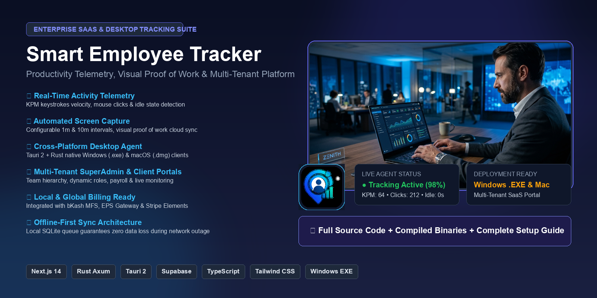
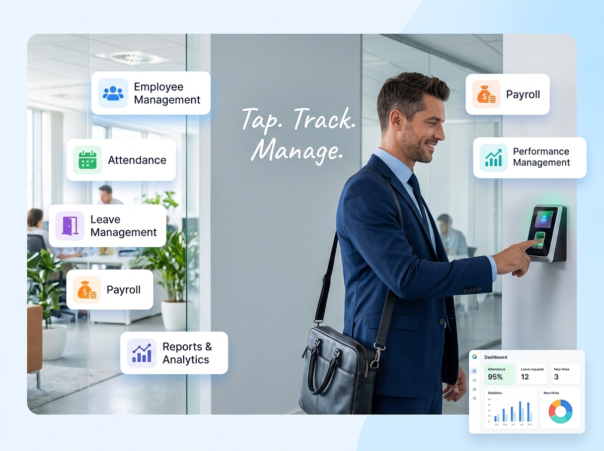
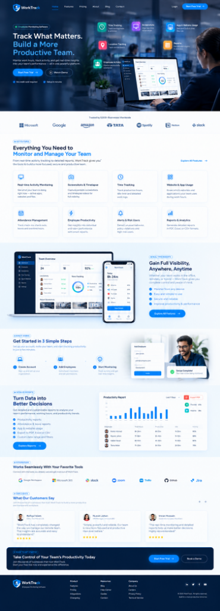
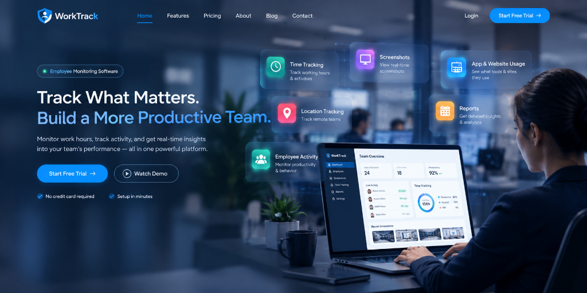

# Smart Employee Tracker

<div align="center">

<p align="center">
  
</p>

### Enterprise Self-Hosted Workforce Analytics & Employee Time Tracking Platform

[](LICENSE)
[](https://github.com/rsmmonaem/smart-employee-tracker/releases)
[](https://nextjs.org/)
[](https://tauri.app/)
[](https://www.rust-lang.org/)
[](https://www.postgresql.org/)
[](https://wa.me/message/rsmmonaemwp)

</div>

---

**Smart Employee Tracker** is an enterprise-grade, self-hosted **Employee Tracker** and workforce productivity monitoring system. It seamlessly unifies a multi-tenant web administration portal with ultra-lightweight desktop tracking agents for **macOS** and **Windows**.

Whether you manage an in-office workforce, remote global contractors, or hybrid teams, Smart Employee Tracker gives you verifiable visual proof of work, automated shift tracking, application usage telemetry, and payroll-ready timesheets with complete data sovereignty and zero vendor lock-in.

---

## 📸 Interface Tour & Visual Showcase

### 1. Central Admin Dashboard & Team Status
Real-time visibility into active employees, on-shift team members, daily work duration, productivity percentages, and immediate visual status across all departments.

<p align="center">
  
</p>

---

### 2. Deep Productivity Telemetry & Activity Analytics
Minute-by-minute breakdown of active desktop applications, visited web domains, productive vs. non-productive categories, and idle time telemetry.

<p align="center">
  
</p>

---

### 3. Native Cross-Platform Desktop Agent
Ultra-lightweight native client built with **Tauri 2** and **Rust** (<30 MB RAM). Features silent background capture, idle timeout detection, native system tray controls, and auto-restart updates.

<p align="center">
  
</p>

---

### 4. Timesheet & Behavioral Analytics Reports
Exportable attendance ledgers, automated shift summaries, weekly work pattern analytics, and payroll-ready reports for HR and management.

<p align="center">
  
</p>

---

## ⚡ Core Features & Capabilities

- **Lightweight Desktop Agent (macOS & Windows):** Native client engineered in Rust & Tauri v2 with minimal system overhead, offline caching, and native OS permission handling.
- **Ultra-Efficient Screen Capture:** Automatic WebP compression engine cutting screenshot storage by **up to 85%** (50–70 KB per screenshot) with crisp text readability.
- **On-Demand Screenshot Streaming:** Secure proxied image streaming with tenant isolation, strict RLS enforcement, and immutable browser caching.
- **Application & Domain Telemetry:** Tracks active application titles and browser URLs without logging intrusive keystrokes or confidential credentials.
- **Automated Attendance & Timesheets:** Automatic shift tracking, breaks, clock-in/out stamps, and exportable CSV reports.
- **1-Click Web-Based Installer (`/install`):** Automated setup wizard that handles database schema migrations, creates storage buckets, and initializes the SuperAdmin profile in seconds.
- **Seamless Auto Updater:** Built-in auto-updater for macOS and Windows desktop agents with zero-friction native restart.
- **True Multi-Tenancy:** Complete tenant isolation powered by PostgreSQL Row-Level Security (RLS) and centralized administration.

---

## 🖥️ Desktop Agent Downloads

| Platform | Latest Release | Previous Release | Notes |
|---|---|---|---|
| **macOS (Apple Silicon M1–M4)** | [v1.1.0 Beta (.dmg)](https://app.tracmatrix.com/downloads/Smart-Employee-Tracker-AppleSilicon.dmg) | [v1.0.0 Stable (.dmg)](https://app.tracmatrix.com/downloads/Smart-Employee-Tracker-macOS-v1.0.0.dmg) | Native ARM64 build |
| **macOS (Intel / Universal)** | [v1.1.0 Beta (.dmg)](https://app.tracmatrix.com/downloads/Smart-Employee-Tracker-macOS.dmg) | [v1.0.0 Stable (.dmg)](https://app.tracmatrix.com/downloads/Smart-Employee-Tracker-macOS-v1.0.0.dmg) | x86_64 compatible |
| **Windows 10 / 11 (64-bit)** | [v1.1.0 Beta (.exe)](https://app.tracmatrix.com/downloads/Smart-Employee-Tracker.exe) | [v1.0.0 Stable (.exe)](https://app.tracmatrix.com/downloads/Smart-Employee-Tracker-v1.0.0.exe) | Portable & Installer |
| **Android (Mobile)** | *Coming Soon* | — | Mobile attendance tracking |

---

## 🏗️ Architecture

```
┌────────────────────────────────────────────────────────┐
│             Web Dashboard & SuperAdmin                 │
│         Next.js 14 (App Router, Tailwind CSS)          │
└──────────────────────────┬─────────────────────────────┘
                           │
             ┌─────────────┴─────────────┐
             ▼                           ▼
┌───────────────────────────┐ ┌──────────────────────────┐
│   PostgreSQL / Supabase   │ │ Native Desktop Agents    │
│  - RLS Tenant Isolation   │ │ - macOS (.dmg)           │
│  - Storage (Screenshots)  │ │ - Windows (.exe)         │
│  - Timesheet & Telemetry  │ │ - Rust + Tauri v2 Engine │
└───────────────────────────┘ └──────────────────────────┘
```

---

## 🚀 Quick Setup & Installation

Smart Employee Tracker supports both automated 1-click web installation and standard manual deployments.

### Option 1: 1-Click Web Installer (Recommended)
1. Deploy the web application to your server (VPS, cPanel, or Docker).
2. Visit `https://your-domain.com/install` in your browser.
3. Follow the 3-step setup wizard:
   - System environment check
   - Automated database migration & Supabase bucket initialization
   - SuperAdmin profile provisioning
4. Your complete employee tracking system is live and secured!

### Option 2: Step-by-Step Manual Deployment
For complete deployment guides including **cPanel Setup**, **Ubuntu VPS Setup**, **PM2 Configuration**, and **Nginx Reverse Proxy**, see:  
👉 **[Read Full Installation Guide (INSTALLATION.md)](docs/INSTALLATION.md)**

---

## 🛠️ Tech Stack

- **Web Application:** Next.js 14 (App Router), React 18, TypeScript, Tailwind CSS, Lucide Icons
- **Desktop Client:** Tauri 2, Rust, Vite, React
- **Database & Storage:** PostgreSQL 15, Supabase Storage (optimized WebP screenshots)
- **Image Processing:** Sharp (high-performance WebP compression engine)
- **Deployment Targets:** Linux VPS (Ubuntu/Debian), cPanel with Node.js Selector, CyberPanel, Docker

---

## 🔐 Security & Privacy

- **Row-Level Security (RLS):** Strict multi-tenant isolation enforced directly at the database layer.
- **Privacy-Compliant Telemetry:** Tracks app titles and activity levels without capturing private keystrokes or sensitive input.
- **Security & Gatekeeper Support:** Packaged bundles with clear permission onboarding for macOS Screen Recording and Accessibility.

---

## 👨‍💻 Author & Support

- **Author & Architect:** **Rsm Monaem** ([LinkedIn Profile](https://www.linkedin.com/in/rsm-monaem/))
- **Direct WhatsApp Support:** **[@rsmmonaemwp](https://wa.me/message/rsmmonaemwp)** (`@rsmmonaemwp`)
- **Issues & Contributions:** Open a ticket on GitHub or reach out via WhatsApp for onboarding and deployment support.

---

## 📄 License

This project is licensed under the [MIT License](LICENSE).
